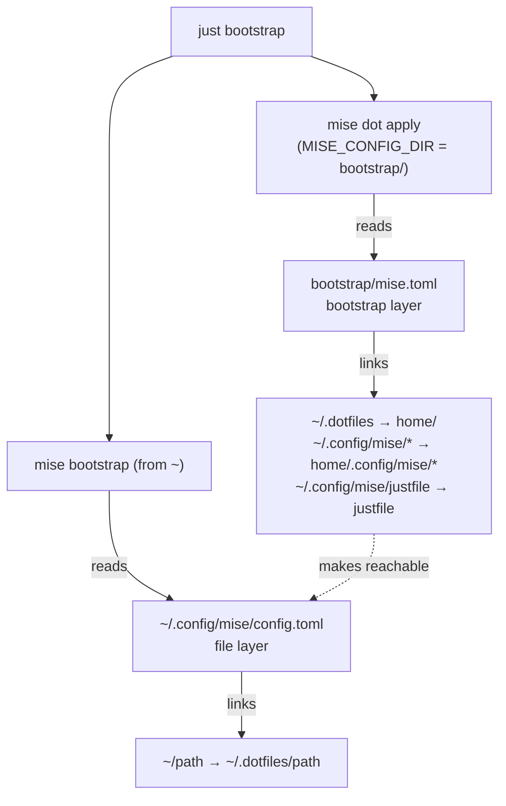

# dotfiles

Personal dotfiles, symlinked into `$HOME` by mise's built-in dotfiles manager
([`mise dot`](https://mise.jdx.dev/dotfiles.html)). CLI tools are installed by
[`mise`](https://mise.jdx.dev) from `home/.config/mise/config.toml`.

## Setup

Prerequisites: `git` and a `mise` recent enough to support `mise dot` variants (2026.9.17
works), plus Homebrew on macOS, which `mise bootstrap` drives to install formulae and casks.
mise installs everything else, including `just`.

```sh
git clone https://github.com/fresh2dev/dotfiles ~/projects/github.com/fresh2dev/dotfiles
cd ~/projects/github.com/fresh2dev/dotfiles
MISE_CONFIG_DIR="$PWD/bootstrap" mise dot apply                  # 1. link ~/.dotfiles and ~/.config/mise
MISE_CONFIG_DIR=~/.config/mise mise exec just -- just bootstrap  # 2. set up the machine (see below)
```

1. `MISE_CONFIG_DIR="$PWD/bootstrap"` makes mise read only `bootstrap/mise.toml`. Its
   links make `home/.config/mise/config.toml` the global config.
2. `MISE_CONFIG_DIR=~/.config/mise` points mise at that global config (your shell sets it
   the same way once `.zshenv` is linked), so every `mise` call in the `justfile` reads it,
   including `config.macos.toml`. `mise exec just --` installs `just` from it on first use.

`just bootstrap` applies the bootstrap layer again, then runs `mise bootstrap`, which
links the file layer and applies the rest of the global config: Homebrew taps, formulae and
casks, user services, macOS settings, tools, and hooks. Last, it clones zsh plugins and
installs agent skills. Its arguments reach only `mise bootstrap`, so
`just bootstrap --dry-run` previews that step but still applies the bootstrap layer and
installs plugins and skills.

Then open a new shell. The linked shell config activates mise, and the bootstrap layer has
linked this repo's `justfile` to `~/.config/mise/justfile`, so `mise run recipes <recipe>`
(the global `recipes` task, which runs `just -f $MISE_CONFIG_DIR/justfile`) runs its recipes
from any directory.

Links that already resolve to the right file count as `applied`, so re-running
`just bootstrap` on a machine that is already set up is safe.

### Dotfiles only

To link the dotfiles without installing packages or tools, changing macOS settings, or
starting services, apply the two layers with `mise dot` directly. This needs only `git`
and `mise`:

```sh
git clone https://github.com/fresh2dev/dotfiles ~/projects/github.com/fresh2dev/dotfiles
cd ~/projects/github.com/fresh2dev/dotfiles
MISE_CONFIG_DIR="$PWD/bootstrap" mise dot apply   # bootstrap layer
cd ~ && mise dot apply                            # file layer
```

Add `--dry-run` to either `mise dot apply` to preview it. The linked mise config is now
your global config, so a new shell activates mise and lazy tools install on first use;
`mise install` installs the eager ones. Run `just bootstrap` later to set up the rest.

## Layout

| Path | Purpose |
|---|---|
| `bootstrap/mise.toml` | Bootstrap layer: links `~/.dotfiles`, `~/.config/mise`, and the `justfile` |
| `home/` | Every dotfile, each at its `$HOME`-relative path |
| `home/.config/mise/config.toml` | File layer. mise's global config, which also pins every other tool |
| `home/.config/mise/config.macos.toml` | macOS-only bootstrap config: Homebrew packages, services, LaunchAgents, `PATH`, `XDG_CONFIG_HOME` and `XDG_DATA_DIRS` for GUI apps, Dock and Finder settings |
| `justfile` | Recipes for installing, upgrading, and formatting, linked to `~/.config/mise/justfile` and run with `mise run recipes`. `mise run recipes --list` shows them, a bare `mise run recipes` opens a chooser |
| `home/.config/dprint/dprint.jsonc` | Global [dprint](https://dprint.dev) config, which also formats this repo |
| `.pre-commit-config.yaml` | [prek](https://prek.j178.dev) hooks: whitespace fixers and syntax, symlink, and safety checks. `prek install` enables them as a git hook |

Linking happens in two layers, each with its own `[dotfiles]` table.



### The bootstrap layer: `bootstrap/mise.toml`

This layer only makes the file layer reachable. It links `~/.dotfiles` to `home/` in this
checkout, links each file in `home/.config/mise` into a real `~/.config/mise` directory
(`symlink-each`), and links the repo's `justfile` to `~/.config/mise/justfile`. Once
applied, mise's global config holds the file layer. Don't add other dotfile entries here.

### The file layer: `home/.config/mise/config.toml`

The `[dotfiles]` table in the global config has one entry per linked path, keyed by its
`~/…` target. The same file sets mise's dotfiles root to `~/.dotfiles` and the default mode
to `symlink`, so an empty entry links `~/<path>` to `home/<path>`:

```toml
"~/.zshrc" = {}
```

An entry can name a single file or a whole directory, and can set `source` to link a target
to a different path under `home/`.

macOS-only entries add an `os = "macos"` variant, which mise applies on macOS and skips
everywhere else. An entry with a variant needs an explicit `mode`; with only `variants`,
mise warns "no recognized operation" and ignores it:

```toml
"~/.hushlogin" = { mode = "symlink", variants = [{ os = "macos" }] }
```

## Which layer `mise dot` sees

Where you run `mise dot` decides which layer it reads:

- **Anywhere, by default**, your shell's `MISE_CONFIG_DIR` (`~/.config/mise`) applies, so
  `mise dot` reads the global config: the file layer. The repo has no `mise.toml` at its
  root, so mise finds no project config there, and a bare `mise dot` inside the repo is safe.
- **With `MISE_CONFIG_DIR="$PWD/bootstrap"`**, `mise dot` reads only `bootstrap/mise.toml`:
  the bootstrap layer. `just bootstrap` does this for you. Set it per command, never
  `export` it: every other `mise` call, in the `justfile` too, would read the bootstrap
  layer instead of the global config.

| Command | Effect |
|---|---|
| `mise run recipes bootstrap [args…]` | Apply both layers and the rest of `mise bootstrap` |
| `MISE_CONFIG_DIR="$PWD/bootstrap" mise dot <subcommand>` | `mise dot <subcommand>` for the bootstrap layer, from the repo root, e.g. `status`, `apply`, `diff` |
| `cd ~ && mise dot <subcommand>` | The same for the file layer |
| `mise run recipes upgrade [args…]` | Prune, then upgrade mise, tools (bumping their pins), Homebrew packages, zsh plugins, and agent skills |
| `mise run recipes prune [args…]` | Remove unused tool versions, undeclared Homebrew formulae, and undeclared casks that mise installed |
| `mise run recipes dir` | Print the path of this checkout, e.g. `cd "$(mise run recipes dir)"` |
| `mise run recipes format-dotfiles` | `dprint fmt` on the repo, using `home/.config/dprint/dprint.jsonc`, then prek's whitespace fixers |

## Homebrew packages

`mise bootstrap` manages Homebrew on macOS; there is no Brewfile. Taps, formulae, and casks
are declared in `home/.config/mise/config.macos.toml`:

```toml
[bootstrap.brew.taps]
"rcmdnk/file" = "https://github.com/rcmdnk/homebrew-file.git"

[bootstrap.packages]
"brew:syncthing" = "latest"
"brew-cask:ghostty" = "latest"
```

Add an entry and run `mise run recipes bootstrap` to install it. To uninstall one, remove its entry and run
`mise run recipes prune`, which removes undeclared formulae and any undeclared cask that mise installed
(casks installed before mise managed them are left alone).

## Adding a file

> [!IMPORTANT]
> Never run `mise dot add` with `MISE_CONFIG_DIR` pointing at `bootstrap/`: it targets the
> bootstrap layer, not the file layer.

From `$HOME` (or anywhere outside the repo), `mise dot add` moves the file into `home/`,
adds a `"~/<path>" = {}` entry to the global config (writing through the symlink into this
repo), and links it:

```sh
cd ~
mise dot add ~/.config/foo/config.toml
```

Given a directory, `mise dot add` links the whole directory. For a macOS-only file, add the
`mode` and `variants` shown above to its entry by hand.

To add a file by hand instead, put it under `home/` at its `$HOME`-relative path, add
`"~/<path>" = {}` to the global config's `[dotfiles]` table, then run
`cd ~ && mise dot apply ~/<path>`.

## Neovim

The Neovim config lives in its own project, f2dvim, which also packages it and its
plugins as a portable, immutable Neovim distribution on PyPI (`uvx f2dvim` runs it).
Clone it beside this repo and run `just link` there to symlink the config to
`~/.config/nvim`; these dotfiles don't link it. The tools and language servers it uses
are still installed by mise from the global config here.
